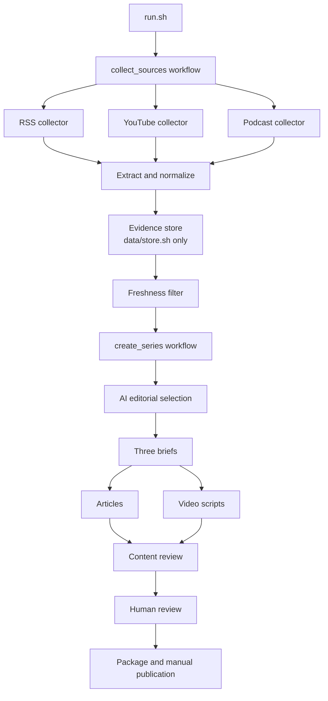

# MIT 1.125 PS04 — Submission

**Student:** Tianyu Zhao  
**Repository:** https://github.com/zhaotianyu0702/mit-1.125-ps4  
**Current status:** The public code and evidence repository is uploaded, and its URL was registered in the course roster's PS4 Repo field on October 15 UTC. The overall assignment remains incomplete because article/video publication and the final published-claim trace are still pending; publication links below are intentionally pending.

## Topic, audience and purpose

**Ship, Then Verify** examines how small software teams can evaluate AI coding assistants. It addresses students and early-career software/ML engineers who know Python, Git and basic testing. The three connected pieces move from workflow design, to interpreting evidence, to a small reversible adoption trial. The production series uses evidence current as of **2026-10-12**.

## Published series

| Piece | Article | Substack URL | YouTube URL |
| --- | --- | --- | --- |
| 1 | Coding agents move into the delivery system | Pending | Pending |
| 2 | What Coding-Agent Results Actually Measure | Pending | Pending |
| 3 | Run a Small, Reversible Trial Before Expanding Agent Access | Pending | Pending |

The approved article/script pairs and source notes are in [the production package](revisions/20261012T225329Z-student-feedback/package/). The three completed companion videos run 3:33.72, 3:51.83 and 3:48.95. Google Vids generated their narration; local finishing added evidence graphics and corrected subtitles. Research, drafting and substantive assistant review were AI-assisted. The student approved the deliverables on October 13 at 19:43 UTC. No personal source-listening claim is made.

**Separate technical demonstration:** shareable URL pending. The approved Elio review copy is 5:28.07. It covers architecture, the entrypoint, retained source/decision/claim evidence, both actual run dates, recovery, editorial revisions and an architectural tradeoff. The final published-claim screen and the statements about pending publication must be updated after publication. Written AI-narration disclosure will remain.

## Setup and execution

Follow [SETUP](docs/SETUP.md). Tested dependencies include Python 3.12, Bash, yt-dlp 2026.8.19, trafilatura 2.3.1 and imageio-ffmpeg 0.6.0, with exact Python versions in [requirements-lock.txt](requirements-lock.txt). Optional local transcription uses whisper-cli with the model in [provenance](models/provenance.json).

Editorial processing used OpenAI Codex CLI 0.162.0-alpha17.2, model `gpt-6-luna`, through an existing ChatGPT login. It did not use an API key or provider fallback. `PS4_CODEX_BIN` can locate an existing Codex executable; `PS4_PYTHON` selects a Python runtime. Configuration and prompts are included and snapshotted per run. No credentials are included.

```bash
python3.12 -m venv .venv
.venv/bin/python -m pip install -r requirements-lock.txt
bash tests/run_checks.sh
bash run.sh
# Resume only on the same actual UTC date:
bash run.sh --resume runs/RUN_ID
# After actual review and matching approval in that checkout:
bash run.sh --package runs/RUN_ID
```

All 41 existing tests, Bash syntax checks and ShellCheck passed in the sanitized staging directory. Fresh content review also passed after reconstructing the evidence store. [Staged logs](docs/STAGED_LOGS.md) explain sanitization and the approval fingerprint's checkout-path limitation. The original approved package passed; its historical approval is preserved, not misrepresented as fresh approval in a relocated checkout.

## Architecture and manual handoffs



The 16 required Bash entrypoints delegate to component-owned Python helpers. `run.sh` captures a real UTC date and orchestrates two workflows: RSS/YouTube/podcast collection, then extraction, the evidence store, date filtering, AI selection, briefs, articles, video scripts, review and reporting. Only `data/store.sh` owns SQLite; other stages exchange JSONL and retained asset paths. Machine checks require exact passages or real timestamp segments and bind review to the content fingerprint.

The human handoff reviews choices, arguments, limitations and corrections, then records approval matching the current review. Video production uses Google Vids followed by local graphics/subtitle finishing. Publishing on Substack/YouTube and formal course registration are separate authorized manual handoffs. No script silently publishes.

## Evidence and actual execution dates

| Full live run | UTC interval | Result | Elapsed / cost |
| --- | --- | --- | --- |
| [20261012T214349Z-992554](runs/20261012T214349Z-992554/) | Oct 12, 21:43:49–22:01:37 | 36 eligible: 30 feed, 2 YouTube, 4 podcast; 7 publishers. 15 accept / 19 reject / 2 defer. Three briefs/articles/scripts; passing mechanical review. | 17m48s across same-date resumes; dollar cost unknown |
| [20261013T000115Z-e07304](runs/20261013T000115Z-e07304/) | Oct 13, 00:01:15–00:21:29 | 36 eligible; 0 new / 1 changed / 35 unchanged. Effective 13 accept / 17 reject / 6 defer. Three briefs/articles/scripts; passing post-correction review. | 20m14s across same-date resumes; dollar cost unknown |

Both directories retain candidate/item/change/eligibility records, decisions, briefs, drafts, reviews, summaries and sanitized operation logs. Per-call usage is retained in [model usage](runs/model_usage.jsonl); unknown dollar cost is not reported as zero. The October 13 version change affected a ReviewBench promotional footer, not its core findings. Repeated collection created no duplicate underlying items.

Earlier collection failures included YouTube caption HTTP 429 responses. A [focused recovery](runs/focused-recovery/) added one video using local Whisper transcription; its 375 segments remain unverified against personal listening. This recovery and the editorial policy replay are not additional full live runs. [Media provenance](docs/MEDIA_PROVENANCE.md) explains omitted downloaded media, public refetch routes and store reconstruction. Content-addressed text/segment assets needed for the retained evidence are included; the SQLite database, raw private model logs and large media are omitted.

The [withheld-real-item replay](docs/validation/withheld-real-item-replay/README.md) is a separately labeled replay over a disposable store, using one exact eligible item from the October 13 run. Starting with 35 records, it reports **1 new + 35 unchanged** when the withheld record is introduced, then **36 unchanged and 0 duplicates** on exact replay. Its script, result, change streams, corpus, freshness outputs, and stage logs are included; copied JSON is a sanitized derivative of the local replay artifacts, with private message identifiers and omitted-media paths removed while timestamps and record/version identities are retained. It is not a third live run.

## Published claim trace

**Pending actual publication.** The prepared chain is article 1's Flywire workflow paragraph → brief claim `01-c2` → accepted `youtube:rAUyRDOFyHU` decision → version `ca1da54d964f56f643c9a4cca6e50469a2a430bf5b1b32a1a8a6ab541700738a` → retained segment `s-0068`, 206.28–210.24 seconds. The public source is [Flywire at 3:26](https://www.youtube.com/watch?v=rAUyRDOFyHU&t=206s). Add the verified Substack URL and exact published passage after publication; this prepared trace is not yet a published claim.

## Editorial review and revision

The student confirmed three accepted examples (GitHub Copilot context guide; Flywire workflow presentation; Practical AI enterprise-deployment podcast) and three rejected/deferred examples (GitHub hackathon article; bug-bounty interview; Oracle productivity account). The [six-item record](revisions/20261012T225329Z-student-feedback/student_review_sample.jsonl) preserves exact item/version and decision comparisons without private message identifiers. The student agreed with the presented sample; no additional personal rationale or full-source listening is invented.

The [v1 policy](config/policy_history/v1-2026-10-12.md) and [current v2 policy](config/editorial_policy.md) show the required meaningful change: a locator must support a claim's meaning, not merely exist. Source inspection found a wrong timestamp and an unsupported “paid API key” qualifier. The assistant corrected those passages, reran selection over the retained corpus, and retained the [before/after comparison](revisions/20261012T222917Z-assistant-v2/policy_comparison.json). The observed v2 results were 17 accept / 16 reject / 3 defer; this was not a causal experiment.

The student accepted policy v2 and asked for a more positive efficiency conclusion on October 12. The revised production series favors active measured trials and expansion where quality holds and total effort falls, while retaining limits on transfer and effect magnitude. The [approval record](revisions/20261012T225329Z-student-feedback/approval.json) and [review note](docs/STUDENT_REVIEW.md) preserve final approval on October 13.

## Personal reflection

AI’s most valuable contribution, in my view, is making it much easier to turn ideas into working tools. It lowers the technical barrier to implementation, so people can begin realizing an idea without first mastering every technology involved. I see the potential for order-of-magnitude efficiency gains, although this project did not measure that magnitude.

One insight I take from this work is that high benchmark performance does not necessarily translate into a useful tool. This is also the limitation that concerns me most: AI development often follows benchmark improvements, while real production work and the skills people actually need may move in a different direction. A higher score alone does not tell us whether an AI system is practical or easy to use.

If I did another round, I would focus on improving interaction with the user—its frequency as well as its format. The process needs more effective opportunities to check that the system and the user still share the same understanding. Otherwise, an early misunderstanding can carry forward, and the workflow can move further and further in the wrong direction. Better interaction would make it easier to recognize and correct that drift.

This public submission text is an edited English rendering of the student’s supplied reflection. It is not a verbatim transcript.

## Architectural tradeoff

Content-addressed assets and versioned records make exact evidence inspectable, but large source media increases storage. Public source URLs can change, so refetching cannot guarantee identical bytes. Long sources use explicitly labeled sampling for model input while locator checks use retained full evidence; omitted context can still change interpretation. Human source review remains necessary because a mechanically valid locator does not prove a claim is sound.
